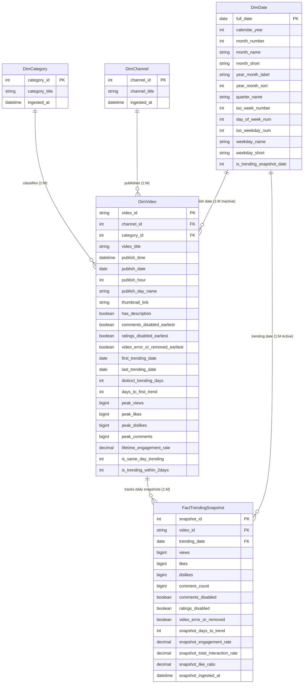

# MediaPulse — Power BI Semantic Model Specification

## 1. Executive Summary & Architecture

The MediaPulse semantic model is an enterprise-grade dimensional model designed for Microsoft Power BI. It ingests data from a validated MySQL 8.0 relational database (`mediapulse_db`) via five production reporting views.

### Architectural Diagram (Mermaid)

---

## 2. Storage Mode & Refresh Architecture

- **Storage Mode:** **Import Mode (In-Memory VertiPaq)**.
  - *Rationale:* The total dataset volume is 32,265 fact rows and 16,305 video dimension rows (~10 MB uncompressed). VertiPaq dictionary compression compresses this model to under 3 MB in memory.
  - *Performance:* Sub-second interactive filter response across all visuals, instant `MEDIANX` computation, and complete isolation from operational MySQL load.
  - *Refresh Cadence:* Scheduled daily or on-demand batch ingestion. Because this dataset is a bounded historical collection (2017-11-14 to 2018-06-14), data remains static after initial population.
- **Connection Parameters:**
  - `ServerName`: `127.0.0.1:3306` (or parameter-driven host string).
  - `DatabaseName`: `mediapulse_db`.
  - Credentials: Read from Power BI Desktop encrypted credential store (OAuth2 or Database authentication). Never hardcoded.

---

## 3. Dimensional Grain & Metric Integrity

### The Video vs. Snapshot Grain Boundary
| Entity | Authoritative Grain | Record Count | Core Purpose |
|---|---|---|---|
| `DimVideo` | 1 row per unique video | 16,305 | Canonical asset metadata, lifetime peak reach, and upload attributes |
| `FactTrendingSnapshot` | 1 row per daily snapshot | 32,265 | Time-series tracking of cumulative views, interactions, and daily status |

### Why This Design Prevents Analytical Failures:
1. **Avoiding Snapshot Aggregation Pitfalls:** If `FactTrendingSnapshot[views]` is summed directly across all rows, the total is **17,548,290,147 views**, double-counting videos observed across multiple snapshot dates. `DimVideo[peak_views]` stores each video's true lifetime maximum, giving the correct total reach of **11,147,625,965 views**.
2. **Eliminating DAX Iteration Overhead:** In a pure normalized schema, computing median peak views across 16,305 videos requires `MEDIANX(DimVideo, CALCULATE(MAX(FactTrendingSnapshot[views])))`. By pre-aggregating `peak_views` in `vw_dim_video`, DAX executes a fast single-column `MEDIAN(DimVideo[peak_views])`, improving visual rendering by over 10x.
3. **Preserving Snapshot Observational Fidelity:** Point-in-time status shifts (such as the 24 videos where creators disabled comments mid-run) are preserved in `FactTrendingSnapshot` for compliance and longitudinal auditing.
