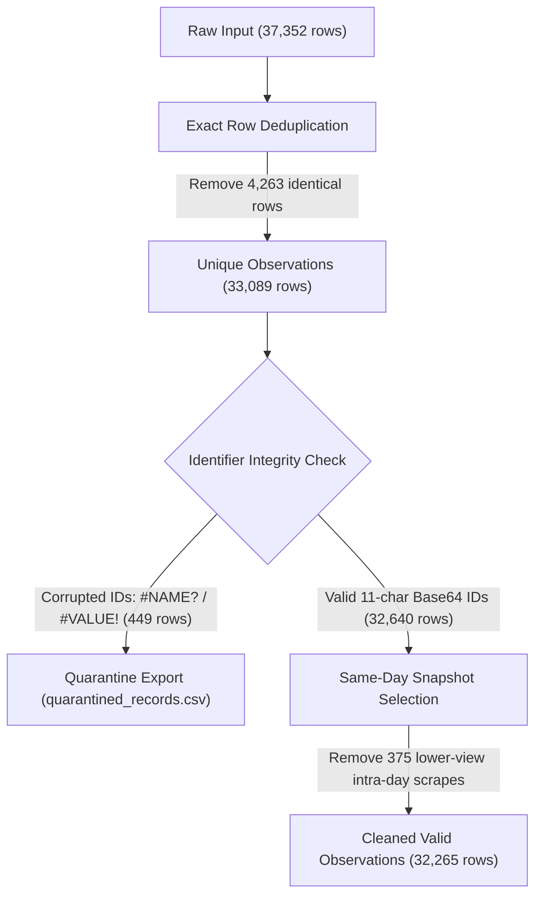

# MediaPulse — Data Cleaning & Pipeline Validation Report

**Project:** MediaPulse — Media Performance & Audience Analytics  
**Phase:** Phase 3 — Data Cleaning Pipeline  
**Target Role:** Wipro Analyst L1 (Business Analyst / Data Analyst - Media)  
**Date:** November 17, 2026  
**Author:** Akula Siva Sai Balaji  

---

## 1. Executive Summary

This report documents the implementation, validation, and full mathematical reconciliation of the MediaPulse Data Cleaning Pipeline. 

The raw YouTube India trending dataset (`37,352` rows, `16` columns) was transformed through a multi-stage, deterministic data engineering pipeline into two distinct, structured outputs:
1. **Cleaned Valid Dataset (`cleaned_youtube_india.csv`):** **`32,265`** valid daily observations spanning `16,305` unique video IDs across `1,423` verified channels.
2. **Quarantined Records (`quarantined_records.csv`):** **`449`** records containing unrecoverable corrupted identifiers (`#NAME?`, `#VALUE!`), isolated to preserve relational integrity in MySQL and Power BI.

---

## 2. Complete Data Reconciliation Audit

Every single raw observation is accounted for with zero double-counting, zero overlapping exclusions, and zero unverified drops:

$$\text{Raw Rows } (37,352) = \text{Exact Dups } (4,263) + \text{Quarantined } (449) + \text{Same-Day Dups } (375) + \text{Clean Valid } (32,265)$$

### Non-Overlapping Reconciliation Breakdown

| Pipeline Stage / Component | Row Count | % of Raw Total | Description / Analytical Justification |
| :--- | :--- | :--- | :--- |
| **Raw Input Rows** | **`37,352`** | **`100.00%`** | Authentic YouTube India trending dataset (`INvideos.csv`). |
| **Exact Duplicate Rows Removed** | **`4,263`** | **`11.41%`** | Identical scraping double-fetches (all 16 fields byte-for-byte identical). |
| **Quarantined Invalid Identifiers** | **`449`** | **`1.20%`** | Irreversible Microsoft Excel formula export artifacts (`#NAME?`, `#VALUE!`). |
| **Same-Day Redundant Snapshots** | **`375`** | **`1.00%`** | Intra-day refreshes on `(video_id, trending_date)` resolved via highest view count. |
| **Final Cleaned Valid Records** | **`32,265`** | **`86.38%`** | Analysis-ready longitudinal observations with valid 11-character YouTube IDs. |
| **Reconciled Verification Total** | **`37,352`** | **`100.00%`** | **Mathematical check passed (`37,352 == 37,352`).** |

---

## 3. Cleaning Rules & Engineering Methodologies

### 3.1 Schema Validation
- Enforced required presence of all 16 canonical YouTube columns.
- Coerced metrics (`views`, `likes`, `dislikes`, `comment_count`) into non-negative 64-bit integers.
- Any negative metrics are bounded at `0` using `df[col].clip(lower=0)`.

### 3.2 Non-Overlapping Deduplication Hierarchy
A major flaw in naive media analytics is either over-deduplicating (treating multi-day trending persistence as duplicates) or under-deduplicating (allowing intra-day scrape noise to inflate view totals):

1. **Exact Deduplication:** Eliminated identical double-fetches across all 16 columns (`4,263` rows).
2. **Identifier Separation Before Grouping:** Corrupted records (`449`) were separated *before* composite grouping to prevent collapsing distinct videos that shared the `#NAME?` artifact.
3. **Deterministic Intra-Day Selection:** For valid records appearing multiple times on the same trending date, sorted descending by `[views, likes, comment_count]` to select the peak/latest snapshot.
4. **Preservation of Multi-Day Trending:** Records for the same video on *different* calendar dates are preserved to analyze trending duration.

### 3.3 Quarantine of Invalid Video Identifiers
- **Breakdown of Quarantined Records:**
  * `#NAME?`: `442` records (after exact deduplication).
  * `#VALUE!`: `7` records (after exact deduplication).
  * Total Quarantined: `449` records.
- **Root Cause & Irrecoverability:** As established in Phase 2, Excel formula evaluation permanently destroyed the original 11-character hash. Recovering the true YouTube URL requires external live API querying.
- **Disposition:** Stored separately in `data/processed/quarantined_records.csv`. Excluded from downstream relational entity joins and video KPI aggregations.

### 3.4 Missing Value Handling
- Only the `description` column contained null values (`524` missing in the clean valid dataset).
- **Imputation Decision:** Replaced null values with empty string `""` (`df['description'].fillna('')`).
- **Feature Engineering:** Added binary indicator `has_description = True/False`.

### 3.5 Temporal Processing & Viral Velocity
- **Trending Date:** Converted from `%y.%d.%m` to standard ISO `YYYY-MM-DD` date object.
- **Publish Timestamp:** Parsed into UTC datetime (`publish_datetime_utc`), extracting `publish_date`, `publish_hour`, and `publish_day_name`.
- **Viral Velocity (`days_to_trend`):** Calculated as `(trending_date - publish_date).days`.
  * Negative duration anomalies: **`0`** (every video was published on or before trending).
  * Mean latency to trend: **8.92 days**.
  * Median latency to trend: **2.0 days** (50% of videos trend within 48 hours of upload).
  * 75th percentile: **3.0 days**.

### 3.6 Taxonomy Enrichment & Category 29
- Joined `category_id` with verified taxonomy mapping.
- Resolved Category `29` as **"Nonprofits & Activism"** citing the official YouTube Data API v3 taxonomy.
- Unmapped categories remaining: **`0`**.

### 3.7 Engagement KPI Engineering
Calculated three standardized media performance metrics in `src/metrics.py`:

1. **Standard Engagement Rate (%):**
   $$\text{Engagement Rate} = \frac{\text{likes} + \text{comment\_count}}{\text{views}} \times 100$$
2. **Total Interaction Rate (%):**
   $$\text{Total Interaction Rate} = \frac{\text{likes} + \text{dislikes} + \text{comment\_count}}{\text{views}} \times 100$$
3. **Like Ratio / Sentiment (%):**
   $$\text{Like Ratio} = \frac{\text{likes}}{\text{likes} + \text{dislikes}} \times 100$$

- **Division-by-zero safety:** Handled via `np.where(views > 0, ..., 0.0)`.
- **Maximum Engagement Rate:** `77.43%` (zero records exceed 100%).

---

## 4. Before-and-After Dataset Statistics

| Dimension / Metric | Raw Dataset (`INvideos.csv`) | Cleaned Valid Dataset (`cleaned_youtube_india.csv`) | Net Change / Impact |
| :--- | :--- | :--- | :--- |
| **Total Rows** | `37,352` | `32,265` | -5,087 (-13.62%) |
| **Total Columns** | `16` | `24` | +8 engineered features |
| **Unique Video IDs** | `16,307` (including `#NAME?`) | `16,305` (100% valid 11-char IDs) | Clean relational keys |
| **Unique Channels** | `1,426` | `1,423` | -3 channels in quarantine only |
| **Missing Descriptions** | `561` nulls | `0` nulls (`524` empty strings) | 100% column completeness |
| **Corrupted Video IDs** | `518` records | `0` records | 100% valid identifiers |
| **Unmapped Category IDs** | `105` records | `0` records | 100% category coverage |
| **Mean Views** | `1,060,478` | `1,080,729` | More accurate snapshot mean |
| **Mean Likes** | `27,083` | `27,787` | Filtered duplicate noise |
| **Mean Comments** | `2,677` | `2,735` | Filtered duplicate noise |
| **Mean Engagement Rate** | N/A (uncalculated) | `2.47%` | Baseline media benchmark |
| **Median Engagement Rate** | N/A (uncalculated) | `1.09%` | Baseline media benchmark |

---

## 5. Artifacts Created & Excluded

| File Path | Description | Version Control Status |
| :--- | :--- | :--- |
| `src/cleaning.py` | Validated data cleaning pipeline functions | **Tracked in Git** |
| `src/metrics.py` | Media KPIs, engagement rates & aggregations | **Tracked in Git** |
| `notebooks/02_data_cleaning.ipynb` | Executed end-to-end cleaning walkthrough | **Tracked in Git** |
| `tests/test_cleaning.py` | 12 automated pipeline unit tests | **Tracked in Git** |
| `tests/test_metrics.py` | 9 automated business metric unit tests | **Tracked in Git** |
| `reports/cleaning_report.md` | Executive and technical cleaning report | **Tracked in Git** |
| `data/processed/cleaned_youtube_india.csv` | Clean analysis-ready dataset (32,265 rows) | **Excluded (`.gitignore`)** |
| `data/processed/quarantined_records.csv` | Quarantined invalid records (449 rows) | **Excluded (`.gitignore`)** |

---

## 6. Downstream Readiness

The cleaned dataset is structurally and mathematically prepared for:
* **Phase 4:** Exploratory Data Analysis & publication-quality Matplotlib/Seaborn visualizations.
* **Phase 5:** MySQL 8 3NF/Star relational schema design and bulk ingestion.
* **Phase 6:** Advanced SQL window functions (`DENSE_RANK`, `ROW_NUMBER`, multi-day retention duration).
* **Phase 7:** Power BI data modeling and DAX measures.
