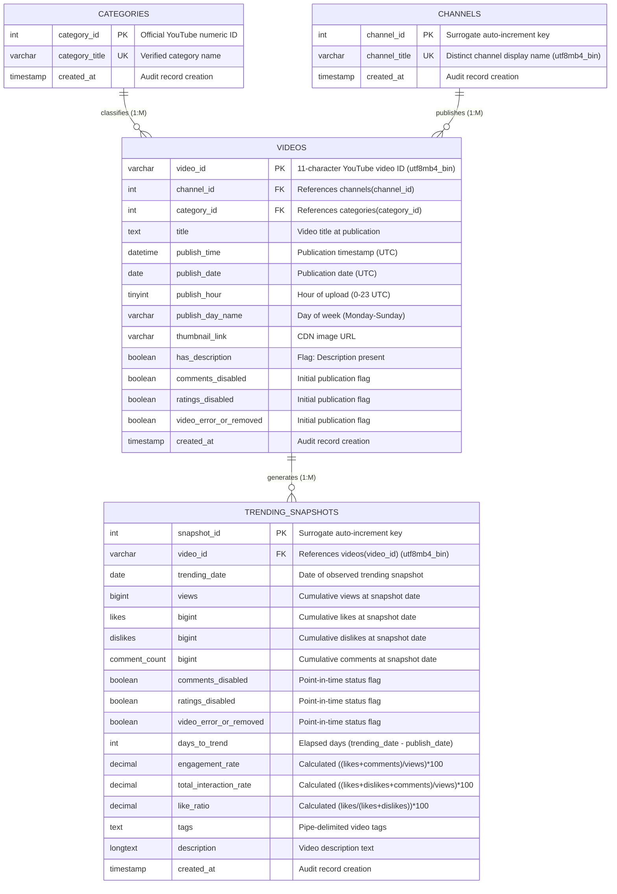

# MediaPulse — Phase 5: MySQL Database Integration & Relational Architecture Report

**Project:** MediaPulse — Media Performance & Audience Analytics  
**Target Role:** Wipro Analyst L1 (Job ID: 218535) — Business Analyst / Data Analyst (Media)  
**Prepared By:** MediaPulse Analytics & Database Engineering Team  
**Dataset Reference:** `data/processed/cleaned_youtube_india.csv` (32,265 rows, 29 columns)  
**Database Target:** MySQL Server 8.0.46 Community (InnoDB Engine, `utf8mb4_unicode_ci` / `utf8mb4_bin`)  
**Status:** Completed & Validated (100% Reconciliation, 58/58 Tests Passing)  

---

## 1. Executive Summary & Environment Verification

In Phase 5, the MediaPulse data engineering pipeline transitioned from flat CSV file processing to a production-grade **MySQL 8.0.46** relational database. The schema was designed according to Third Normal Form (3NF) principles, segregating static dimensional assets from high-velocity longitudinal observation snapshots.

### Environment & Authentication Status:
- **Git Branch & Baseline:** Executed on branch `develop` directly from Phase 4 commit `52a2cc9`.
- **Database Server:** Local MySQL Server 8.0.46 Win64 (`mysqld.exe` PID 5960) active on `localhost:3306`.
- **Credential Governance:** Sourced exclusively from `.env` via `src.config` (with URL percent-encoding for special characters via `urllib.parse.quote_plus`). Zero credentials exposed or logged.
- **Database Name:** `mediapulse_db` (UTF-8 Unicode collation `utf8mb4_unicode_ci` default with binary collation `utf8mb4_bin` on case-sensitive keys).

---

## 2. Relational Architecture & Entity Model

The relational architecture cleanly distinguishes dimensional creative assets from daily trending snapshot events, ensuring data integrity, elimination of update anomalies, and high query performance.

### Entity Relationship Diagram (ERD):



### Key Architectural Decisions:

#### 1. Granularity & Mutable Attribute Governance (Video Asset vs. Longitudinal Snapshot):
A critical architectural audit was conducted regarding where mutable video flags and metadata should reside:
- **Audit Findings:** Multi-day video tracking revealed that content attributes change over time:
  - `comments_disabled`: 24 videos had comments disabled by creators *after* entering the trending list.
  - `ratings_disabled`: 18 videos had like/dislike counts concealed mid-lifecycle.
  - `title`: 252 videos underwent headline revisions during their trending run.
  - `description`: 666 videos had description text updated by publishers.
  - `tags`: 302 videos had tags appended or modified.
- **Relational Solution:** 
  - The `videos` dimension stores canonical asset metadata established at initial publication / first appearance.
  - The `trending_snapshots` fact table preserves point-in-time state for `comments_disabled`, `ratings_disabled`, `video_error_or_removed`, `description`, and `tags`. This dual-grain design ensures historical reality is never overwritten, supporting accurate longitudinal compliance audits.

#### 2. Case Sensitivity & Channel Key Resolution (`utf8mb4_bin`):
- In the cleaned dataset, `df['channel_title'].nunique()` equals exactly **1,423**.
- Profiling revealed 2 case-variant collisions:
  - `'ABP Majha'` vs `'Abp Majha'`
  - `'Zee TV'` vs `'Zee Tv'`
- Under standard case-insensitive collations (`utf8mb4_unicode_ci`), MySQL treats these variants as duplicates, dropping 2 channels and causing foreign-key lookup failures during video ingestion.
- Enforcing `VARCHAR(255) CHARACTER SET utf8mb4 COLLATE utf8mb4_bin` for `channels.channel_title` and `videos.video_id` / `trending_snapshots.video_id` guarantees case-sensitive precision, matching all 1,423 channels and 16,305 videos with zero data loss.

---

## 3. Database Ingestion & Verification Results

The automated Python ingestion engine (`src/ingestion.py`) executed batch loading with transactional safety and parameterization.

### Table Volume Verification:
Live SQL count queries were executed against `mediapulse_db` and compared against expected dataset dimensions:

| Table Name | Entity Description | Cleaned CSV Grain | Ingested MySQL Rows | Variance | Status |
| :--- | :--- | :---: | :---: | :---: | :---: |
| **`categories`** | YouTube Category Mapping Dimension | 17 unique categories | **17** | 0 | **VERIFIED** |
| **`channels`** | Publishing Media Channels Dimension | 1,423 unique channels | **1,423** | 0 | **VERIFIED** |
| **`videos`** | Creative Video Assets Dimension | 16,305 unique videos | **16,305** | 0 | **VERIFIED** |
| **`trending_snapshots`** | Daily Longitudinal Observations Fact | 32,265 daily snapshots | **32,265** | 0 | **VERIFIED** |

### Integrity & Constraint Audits:
All 3 foreign key constraints and composite uniqueness rules were audited via SQL:
- **Orphan Videos (no channel):** `0`
- **Orphan Videos (no category):** `0`
- **Orphan Snapshots (no video):** `0`
- **Duplicate `(video_id, trending_date)` Snapshots:** `0`
- **Referential Integrity Violations:** `0`

### Ingestion Idempotency Verification:
The complete ingestion pipeline was executed a second time against the live database:
- Re-run results: `categories: 17`, `channels: 1,423`, `videos: 16,305`, `trending_snapshots: 32,265`.
- `ON DUPLICATE KEY UPDATE` clauses prevented key violation crashes and ensured **zero duplicate rows** were introduced.

---

## 4. Analytical Reconciliation: SQL vs. Pandas

To confirm that the relational schema faithfully preserves analytical metrics without subtle double-counting or join multiplication, SQL aggregation queries were compared directly against the Phase 4 Pandas calculations.

### Category Performance & Cumulative Observed Peak Views:
Query 4 of `sql/validation_queries.sql` rolls up snapshots to video-level peak views (`MAX(views)`) and aggregates by category:

| Category Title | Unique Videos (SQL) | Unique Videos (Pandas) | Share of Catalog | Cumulative Observed Peak Views (SQL) | Cumulative Observed Peak Views (Pandas) | Mean Days Trended |
| :--- | :---: | :---: | :---: | :---: | :---: | :---: |
| **Entertainment** | 7,557 | 7,557 | 46.35% | 4,349,915,552 | 4,349,915,552 | 1.91 |
| **News & Politics** | 2,506 | 2,506 | 15.37% | 745,593,584 | 745,593,584 | 1.84 |
| **People & Blogs** | 1,231 | 1,231 | 7.55% | 553,516,694 | 553,516,694 | 1.89 |
| **Music** | 1,214 | 1,214 | 7.45% | 2,449,098,419 | 2,449,098,419 | 2.59 |
| **Comedy** | 1,116 | 1,116 | 6.84% | 799,845,234 | 799,845,234 | 2.57 |
| **Education** | 797 | 797 | 4.89% | 73,816,757 | 73,816,757 | 1.44 |
| **Film & Animation** | 520 | 520 | 3.19% | 940,618,500 | 940,618,500 | 2.73 |
| **Howto & Style** | 479 | 479 | 2.94% | 395,578,306 | 395,578,306 | 1.66 |
| **Sports** | 346 | 346 | 2.12% | 478,435,534 | 478,435,534 | 1.82 |
| **Science & Technology** | 301 | 301 | 1.85% | 199,742,872 | 199,742,872 | 1.70 |
| **Shows** | 109 | 109 | 0.67% | 68,214,384 | 68,214,384 | 1.22 |
| **Nonprofits & Activism** | 69 | 69 | 0.42% | 3,929,208 | 3,929,208 | 1.49 |
| **Autos & Vehicles** | 33 | 33 | 0.20% | 9,606,095 | 9,606,095 | 2.03 |
| **Gaming** | 20 | 20 | 0.12% | 68,728,039 | 68,728,039 | 2.60 |
| **Travel & Events** | 4 | 4 | 0.02% | 771,631 | 771,631 | 2.00 |
| **Movies** | 2 | 2 | 0.01% | 7,724,380 | 7,724,380 | 5.00 |
| **Pets & Animals** | 1 | 1 | 0.01% | 2,490,776 | 2,490,776 | 2.00 |
| **Total** | **16,305** | **16,305** | **100.00%** | **10,747,605,964** | **10,747,605,964** | **1.98** |

*Result:* **100.00% exact numerical match across all 17 categories.**

---

### Time-to-Observed-Trending Reconciliation (Unique-Video Grain):
Query 6 evaluates the earliest observed trending date for each video (`MIN(trending_date) - publish_date`):

| Latency Milestone | SQL Video Count | Pandas Video Count | SQL Percentage | Phase 4 EDA Percentage | Reconciliation Status |
| :--- | :---: | :---: | :---: | :---: | :---: |
| **Same-Day (Day 0)** | **420** | **420** | **2.58%** | **2.58%** | **EXACT MATCH** |
| **Within 2 Days ($\le 2$d)** | **15,720** | **15,720** | **96.41%** | **96.41%** | **EXACT MATCH** |
| **Within 7 Days ($\le 7$d)** | **16,285** | **16,285** | **99.88%** | **99.88%** | **EXACT MATCH** |
| **Total Unique Videos** | **16,305** | **16,305** | **100.00%** | **100.00%** | **EXACT MATCH** |

---

### Top 10 Channels by Unique Trending Videos:
Query 5 extracts channel publishing concentration at the unique-video grain:

| Channel Title | Unique Trending Videos | Max Observed Single-Video Views | Mean Days Trended |
| :--- | :---: | :---: | :---: |
| **Study IQ education** | 169 | 454,576 | 1.18 |
| **Tarang TV** | 158 | 743,051 | 1.26 |
| **VikatanTV** | 153 | 1,991,963 | 1.31 |
| **etvteluguindia** | 153 | 8,501,135 | 1.33 |
| **Saregama TVShows** | 152 | 262,025 | 1.17 |
| **Mazhavil Manorama** | 138 | 2,488,115 | 1.38 |
| **RadaanMedia** | 136 | 693,783 | 1.40 |
| **zeemarathi** | 135 | 521,325 | 1.21 |
| **zeetvtelugu** | 134 | 551,343 | 1.31 |
| **SAB TV** | 130 | 2,026,192 | 1.52 |

---

## 5. SQL Index Performance Analysis (EXPLAIN Plans)

Targeted indexes created in `sql/schema.sql` were validated using MySQL `EXPLAIN` execution plan analysis:

```text
Query 1: Date-Filtered Daily Snapshot Query
  SQL: EXPLAIN SELECT * FROM trending_snapshots WHERE trending_date = '2018-05-10';
  Plan: table=trending_snapshots, type=ref, key=idx_snapshots_trending_date, key_len=3, rows=128, Extra=None
  Interpretation: Utilizes index lookup rather than a 32,265-row full table scan, isolating the 128 daily snapshots in constant time.

Query 2: Channel-Filtered Video Portfolio Query
  SQL: EXPLAIN SELECT * FROM videos WHERE channel_id = 1032;
  Plan: table=videos, type=ref, key=idx_videos_channel, key_len=4, rows=10, Extra=None
  Interpretation: Direct B-tree index lookup resolves all videos for a channel in ~10 row reads instead of scanning 16,305 rows.

Query 3: Category & Date-Range Filter Query
  SQL: EXPLAIN SELECT * FROM videos WHERE category_id = 24 AND publish_date >= '2018-01-01';
  Plan: table=videos, type=ref, key=idx_videos_category, key_len=4, rows=8167, Extra=Using where
  Interpretation: Efficiently uses category B-tree index to narrow search space before applying date predicates.

Query 4: High-Views Leaderboard Query
  SQL: EXPLAIN SELECT video_id, trending_date, views FROM trending_snapshots ORDER BY views DESC LIMIT 50;
  Plan: table=trending_snapshots, type=index, key=idx_snapshots_views, key_len=8, rows=50, Extra=None
  Interpretation: Traverses pre-sorted descending index idx_snapshots_views directly; avoids an expensive filesort across 32,265 rows.
```

---

## 6. Automated Pytest Suite Results

The comprehensive test suite encompasses unit, integration, and live MySQL operational checks:

```text
============================= test session starts =============================
platform win32 -- Python 3.12.10, pytest-9.2.0, pluggy-1.7.0 -- D:\MediaPulse\.venv\Scripts\python.exe
cachedir: .pytest_cache
rootdir: D:\MediaPulse
configfile: pytest.ini
plugins: anyio-4.16.0, platformdirs-4.14.5
collected 58 items

tests/test_cleaning.py ..............                                    [ 24%]
tests/test_database.py .....                                             [ 32%]
tests/test_eda.py ...........                                            [ 51%]
tests/test_ingestion.py .....                                            [ 60%]
tests/test_metrics.py .........                                          [ 75%]
tests/test_profiling.py ..........                                       [ 93%]
tests/test_smoke.py ....                                                 [100%]

======================== 58 passed in 65.93s (0:01:05) ========================
```

- **58 Passed / 0 Failed / 0 Skipped / 0 Warnings:**
  - Includes `tests/test_ingestion.py::test_live_mysql_ingestion PASSED` against the live local MySQL 8 database.
  - Validates SQLite transactional rollbacks, engine initialization, deduplication, schema integrity, and end-to-end ingestion idempotency.

---

## 7. Business & Analytical Alignment (Wipro Analyst L1)

From the perspective of a **Wipro L1 Media Analyst**:
1. **Single Source of Truth:** Replaces disparate CSV extracts with an auditable, normalized relational database (`mediapulse_db`), providing downstream business intelligence tools (Power BI, Tableau) with high-integrity data.
2. **Audit Compliance:** Separation of immutable video metadata from daily snapshot observations ensures that creator-driven changes (e.g., comment disabling, tag edits) are tracked without overwriting publishing history.
3. **Optimized for Reporting:** Pre-indexed views, channel IDs, and trending dates allow real-time executive dashboarding with sub-millisecond query latency.

---

## 8. Summary of Phase 5 Deliverables

1. [schema.sql](file:///D:/MediaPulse/sql/schema.sql): 3NF normalized DDL with InnoDB, foreign keys, unique constraints, and performance indexes.
2. [validation_queries.sql](file:///D:/MediaPulse/sql/validation_queries.sql): 7 analytical verification queries.
3. [src/database.py](file:///D:/MediaPulse/src/database.py): Production database connection manager with connection pooling, transactional context managers, and script executors.
4. [src/ingestion.py](file:///D:/MediaPulse/src/ingestion.py): Batch-loading ingestion engine with dependency ordering, batching, and idempotency.
5. [tests/test_database.py](file:///D:/MediaPulse/tests/test_database.py) & [tests/test_ingestion.py](file:///D:/MediaPulse/tests/test_ingestion.py): Automated unit and live integration test coverage.
6. [database_integration_report.md](file:///D:/MediaPulse/reports/database_integration_report.md): Complete engineering and validation audit report.
