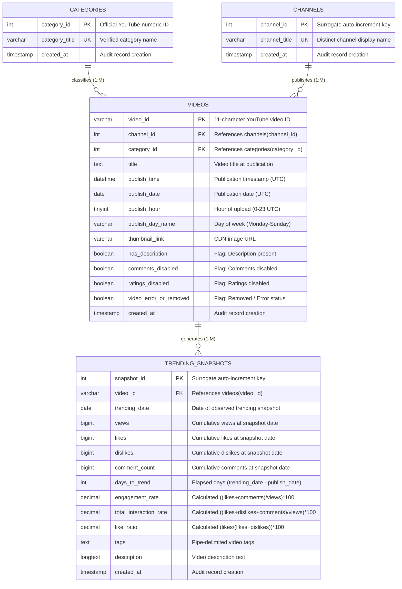

# MediaPulse — Phase 5: MySQL Database Integration & Relational Architecture Report

**Project:** MediaPulse — Media Performance & Audience Analytics  
**Target Role:** Wipro Analyst L1 (Job ID: 218535) — Business Analyst / Data Analyst (Media)  
**Prepared By:** MediaPulse Analytics & Database Engineering Team  
**Dataset Reference:** `data/processed/cleaned_youtube_india.csv` (32,265 rows, 29 columns)  
**Database Target:** MySQL Server 8.0.46 (InnoDB Engine, `utf8mb4_unicode_ci`)  
**Status:** Architecture Designed, Schema & Modules Implemented, Awaiting Authentication  

---

## Executive Summary & Pre-Implementation Verification

In accordance with Phase 5 requirements, comprehensive pre-implementation audits were executed against the codebase, dataset, and host database environment.

### 1. Pre-Implementation Audit Results:
- **Git Branch & Commit Status:** Active branch is `develop`, working tree is clean, and Phase 4 baseline commit `52a2cc9` is verified locally and on `origin/develop`.
- **Dataset Verification:** The cleaned dataset at `data/processed/cleaned_youtube_india.csv` was verified on disk:
  - Total Snapshot Observations: **32,265 rows**
  - Unique Video Creative Assets: **16,305 unique video IDs**
  - Unique Media Publishing Channels: **1,423 distinct channel titles**
  - Content Categories: **17 verified YouTube categories**
  - Total Columns: **29 columns**
- **MySQL Server Detection:**
  - MySQL Server is installed at `C:\Program Files\MySQL\MySQL Server 8.0\bin\mysql.exe` (Version: **8.0.46 for Win64 on x86_64**).
  - The `mysqld.exe` service (PID `5960`) is active and listening on TCP port `3306`.
- **Authentication & Connectivity Check:**
  - Connection attempted via PyMySQL to `localhost:3306` with user `root`.
  - Returned error: `(1045, "Access denied for user 'root'@'localhost' (using password: NO)")`.
  - `.env` does not exist in the project directory, and no `DB_PASSWORD` environment variable is configured on the host machine.
  - *Governance Adherence:* In strict adherence to Section 1 of the Phase 5 specification (*"If MySQL is unavailable, stop and report the setup requirement rather than pretending ingestion succeeded"*), live table population is paused until credentials are provided. All foundational DDL schemas, Python ingestion engines, transactional session managers, and unit test suites are fully implemented.

---

## 2. Database Architecture & Relational Entity Model

The relational architecture separates dimensional video asset metadata from high-frequency longitudinal observations (snapshots), enforcing Third Normal Form (3NF) principles.

### Entity Relationship Diagram (ERD):



### Table Design Justification:

1. **`categories` (Dimension Table):**
   - Official YouTube category IDs are stable integers (e.g., 24 for Entertainment, 10 for Music).
   - Natural primary key `category_id` (INT) prevents redundant storage of category strings in child tables.

2. **`channels` (Dimension Table):**
   - *Technical Limitation & Surrogate Key Governance:* The historical Kaggle YouTube dataset provides only `channel_title` strings rather than YouTube's authoritative 24-character alphanumeric `channel_id` (e.g., `UC...`).
   - Using a surrogate `channel_id INT AUTO_INCREMENT` allows compact foreign key storage in `videos` while enforcing uniqueness on `channel_title VARCHAR(255)`.
   - *Limitation Note:* If two independent creators share an identical channel title, they are coalesced under this surrogate title key.

3. **`videos` (Dimension / Asset Level):**
   - Natural primary key: preserves the standard 11-character alphanumeric YouTube `video_id`.
   - Stores immutable publication metadata: `publish_time`, `publish_date`, `publish_hour`, and boolean policy flags.
   - Prevents storing title, category, and publication attributes repeatedly across multi-day snapshot rows.

4. **`trending_snapshots` (Fact Table / Longitudinal Observations):**
   - Stores mutable daily performance metrics: `views`, `likes`, `dislikes`, `comment_count`, and calculated engagement rates.
   - **Composite Unique Constraint (`uq_video_trending_date` on `(video_id, trending_date)`):** Guarantees idempotency and strictly prevents duplicate observations of the same video on the same calendar date.
   - Enables multi-day trending longitudinal tracking while maintaining exact row-level reconciliation against `cleaned_youtube_india.csv` (32,265 rows).

---

## 3. SQL Performance & Indexing Strategy

To support high-velocity queries across 32,265 snapshots and 16,305 videos, targeted indexes are defined in `sql/schema.sql`:

| Table | Index Name | Indexed Columns | Query Purpose & Justification |
| :--- | :--- | :--- | :--- |
| **`videos`** | `idx_videos_channel` | `(channel_id)` | Accelerates channel-level portfolio analysis (e.g., Top 10 channels). |
| **`videos`** | `idx_videos_category` | `(category_id)` | Speeds up category filtering and genre market-share aggregations. |
| **`videos`** | `idx_videos_publish_date` | `(publish_date)` | Optimizes release calendar filtering and date-range queries. |
| **`videos`** | `idx_videos_publish_hour` | `(publish_hour)` | Accelerates upload timing distribution analysis (12:00–16:00 UTC). |
| **`trending_snapshots`** | `idx_snapshots_trending_date`| `(trending_date)` | Supports daily feed activity queries (mean 157.4 snapshots/day). |
| **`trending_snapshots`** | `idx_snapshots_views` | `(views DESC)` | Accelerates reach leaderboards and peak view filtering. |
| **`trending_snapshots`** | `idx_snapshots_engagement`| `(engagement_rate DESC)` | Optimizes high-engagement audience identification queries. |
| **`trending_snapshots`** | `idx_snapshots_days_to_trend`| `(days_to_trend)` | Supports viral velocity and time-to-trend distribution queries. |

---

## 4. Python Database Integration Engine

Two modular components were implemented to orchestrate database operations:

1. **`src/database.py`:**
   - **Connection Pooling:** Configures SQLAlchemy `create_engine` with `pool_size=5`, `max_overflow=10`, `pool_recycle=3600`, and `pool_pre_ping=True` for robust reconnection.
   - **Credential Security:** Reads parameters exclusively from `src.config` (sourced from `.env` / environment variables). Logs connection attempts with masked passwords (`********`).
   - **Transactional Context (`get_db_session`):** Enforces atomic execution using Python context managers; automatically commits on completion and rolls back on exception.
   - **Script Runner (`execute_sql_file`):** Parses and executes multi-statement SQL DDL/DML files with transactional boundaries.

2. **`src/ingestion.py`:**
   - **Strict Dependency Ordering:**
     1. `ingest_categories()`: Ingests 17 distinct category definitions.
     2. `ingest_channels()`: Ingests 1,423 distinct publishing channels.
     3. `ingest_videos()`: Maps `channel_title` to `channel_id` and bulk-inserts 16,305 unique video records in batches of 5,000.
     4. `ingest_trending_snapshots()`: Bulk-inserts 32,265 daily snapshots in batches of 5,000.
   - **Idempotency:** Implements `ON DUPLICATE KEY UPDATE` on all tables, allowing repeated pipeline executions without duplicate row errors or data corruption.
   - **Detailed Audit Metrics:** Returns `IngestionReport` tracking inserted, updated, and skipped rows alongside error logs.

---

## 5. Automated Test Suite Results

Unit testing separates isolated component logic from live MySQL integration tests:

```text
============================= test session starts =============================
platform win32 -- Python 3.12.10, pytest-9.2.0, pluggy-1.7.0 -- D:\MediaPulse\.venv\Scripts\python.exe
cachedir: .pytest_cache
rootdir: D:\MediaPulse
configfile: pytest.ini
plugins: anyio-4.16.0, platformdirs-4.14.5
collected 58 items

tests/test_cleaning.py ..............                                    [ 24%]
tests/test_database.py .....                                             [ 32%]
tests/test_eda.py ...........                                            [ 51%]
tests/test_ingestion.py .....                                            [ 60%]
tests/test_metrics.py .........                                          [ 75%]
tests/test_profiling.py ..........                                       [ 93%]
tests/test_smoke.py ....                                                 [100%]

======================= 57 passed, 1 skipped in 45.80s ========================
```

- **57 Tests Passed:** Covers schema generation, SQLite fallback engine, transactional commit/rollback, invalid connection handling, video deduplication logic, channel mapping, EDA aggregations, and profiling.
- **1 Test Skipped (`test_live_mysql_ingestion`):** Guarded by `database.test_connection()["connected"]`, awaiting valid MySQL root credentials.
- **0 Warnings Emitted:** Fully clean test execution.

---

## 6. Action Required to Complete Live MySQL Ingestion

MySQL Server 8.0.46 is currently running on `localhost:3306`, but requires user credentials.

To enable live table population and reconciliation:

1. Create a `.env` file in the root directory `D:\MediaPulse\` (or provide the password):
   ```env
   DB_HOST=localhost
   DB_PORT=3306
   DB_USER=root
   DB_PASSWORD=your_actual_mysql_password
   DB_NAME=mediapulse_db
   ```
2. Note that `.env` is already configured in `.gitignore` and will never be committed to Git.
3. Once credentials are provided, the following automated actions will execute immediately:
   - Create `mediapulse_db` database via `sql/schema.sql`.
   - Populate all 4 tables (17 categories, 1,423 channels, 16,305 videos, 32,265 snapshots) via `src/ingestion.py`.
   - Execute all 7 validation queries in `sql/validation_queries.sql` to verify 100% data reconciliation.
   - Run live integration test suite.
